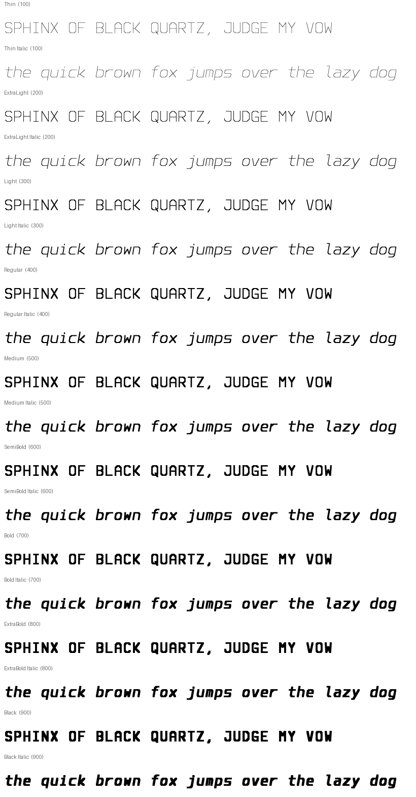

# NullType

An original chamfered monospace for terminals and code: 9 weights + italics, source-preserving ligatures, full box drawing and Powerline.



> **Status:** 1.000 released — see Releases. Site: https://r3dg0d.github.io/nulltype-font/

## Styles and formats
9 weights × 2 slopes = **18 static styles**, each as **TTF** (TrueType outlines), **OTF** (CFF outlines), and **WOFF2**, for 54 files. There are also **2 variable fonts** (`wght` 100–900: `NullType[wght]` and `NullType-Italic[wght]`, TTF + WOFF2).

| Weight | 100 | 200 | 300 | 400 | 500 | 600 | 700 | 800 | 900 |
|---|---|---|---|---|---|---|---|---|---|
| Name | Thin | ExtraLight | Light | Regular | Medium | SemiBold | Bold | ExtraBold | Black |

Each has an Italic. Naming follows the RIBBI model: Regular, Italic, Bold, and Bold Italic share family `NullType`. Other weights use family `NullType <Weight>` (name ID 1/2) plus typographic names `NullType` / `<Style>` (ID 16/17).

**Variable fonts:** Built from all 9 masters per slope. Pen width/height interpolate linearly, so every intermediate weight is a valid stroke font.

## Design
NullType is a **600-unit monospace** (cap 700, x-height 500, line cell 1200) built from stroke skeletons with 45° chamfered corners.

* Every segment is swept by an upright rectangular pen. Stems are 18 units at Thin, 72 at Regular, 140 at Black.
* **Bars thin relative to stems** above Regular (92% → 80%) to keep horizontal counters (`e a s 8 B`) open. This is a weight-dependent contrast model, not a uniform offset.
* The stem-centre box is **inset by half a stem** at every weight, so heavy weights don't eat sidebearings and every weight fills the same cell. `m` gets a 75% middle stem.
* **Italics** shear the skeleton 10° around mid-x-height while the pen stays upright, so stem widths stay constant.
* The default zero is **dotted** (the “null dot”). `zero` gives slashed and `ss01` plain. `0 O o`, `1 l I |`, and `5 S` are distinct in every weight (see the confusables sheet).

## Where it shines
NullType is built for **code and terminals**. Every glyph is 600 units wide in every weight and italic (tested). The line cell is 1200 units, and box drawing and Powerline glyphs fill it exactly, so TUIs connect without gaps.

### Ligatures that never touch your text
`->`, `<-`, `=>`, `==` and `!=` are drawn as two cell-wide pieces chosen by `calt` contextual alternates. The glyph count, every advance, and HarfBuzz cluster mapping stay identical to the input. Cursor movement, selection, copy/paste and search all see the original characters. `===`, `!==` and `==>` are deliberately left unligated so equality operators stay unambiguous. Turn ligatures off with `font-feature-settings: "calt" 0` or your editor's ligature setting.

| Use | Suggested styles |
|---|---|
| Editors, 12–16 px | Regular, Medium; Light on high-DPI |
| Terminals with dark themes | Light–Regular |
| Presentations / headings | SemiBold–Black |

## OpenType features
`calt` (code ligatures `-> <- => == !=`, one-to-one, cluster-preserving), `zero` (slashed zero), `ss01` (plain zero).

## Coverage
389 glyphs, 376 encoded code points (full manifest: [docs/COVERAGE.md](docs/COVERAGE.md), [docs/coverage.json](docs/coverage.json)).

| Block | Code points |
|---|---|
| Basic Latin | 95 |
| Latin-1 Supplement | 93 |
| Latin Extended-A | 2 |
| General Punctuation | 10 |
| Currency Symbols | 1 |
| Arrows | 4 |
| Mathematical Operators | 4 |
| Box Drawing | 128 |
| Block Elements | 32 |
| Private Use (Powerline) | 7 |

Not yet covered: ¼ ½ ¾ (U+00BC–00BE), Latin Extended-A beyond ı/Ÿ, Greek, Cyrillic, and Nerd Font icons.

## Install

### Linux (per user)
```sh
mkdir -p ~/.local/share/fonts/NullType
cp fonts/otf/*.otf fonts/variable/*.ttf ~/.local/share/fonts/NullType/   # or unzip the release archive
fc-cache -f ~/.local/share/fonts
fc-list | grep -i nulltype
```
Install either the static OTFs **or** the TTFs, not both, to avoid duplicate menu entries. The variable TTFs can sit alongside the static fonts.

### Nix / NixOS
```nix
# flake input:  nulltype.url = "github:r3dg0d/nulltype-font";
fonts.packages = [ inputs.nulltype.packages.${pkgs.system}.default ];
```
Or `nix build .#nulltype` in this repo (it builds from source and runs the test suite).

### Arch Linux
`packaging/PKGBUILD` installs a release archive. Fill in the checksum once a release exists.

### Web
```html
<link rel="stylesheet" href="css/nulltype.css">            <!-- static, Latin + terminal subsets -->
<link rel="stylesheet" href="css/nulltype-variable.css">   <!-- family "NullType Variable" -->
```
```css
body { font-family: "NullType", monospace; font-feature-settings: "zero" 0; }
```
Terminal and editor snippets: [docs/terminals.md](docs/terminals.md).

## Build from source
```sh
nix develop          # or nix-shell
make fonts           # deterministic: sources/ufo → fonts/{ttf,otf,woff2,variable} + SHA256SUMS
make test            # pytest suite
python3 tools/webfonts.py && python3 tools/qa.py all   # subsets, CSS, specimens, coverage, regression
make fontbakery      # FontBakery universal profile → docs/fontbakery-*.md
make site            # showcase site → site/dist
```
Source of truth: `sources/skeletons.txt` and `tools/engine.py` (polyline skeleton on an 8×14 grid → upright rectangular pen (Minkowski hexagons) → pathops union). The UFO masters and designspaces in `sources/` are generated from those and kept editable.

## Quality assurance
See [docs/QA.md](docs/QA.md) for real results from the latest local build: pytest, FontBakery, OTS, rasterisation, shaping, and visual regression.

## License
* Fonts and font sources: **SIL Open Font License 1.1** with Reserved Font Name **“NullType”**. See [OFL.txt](OFL.txt).
* Build tooling: **MIT**. See [LICENSE-TOOLS](LICENSE-TOOLS).

Copyright 2026 Vincent Patrick Chambers.
